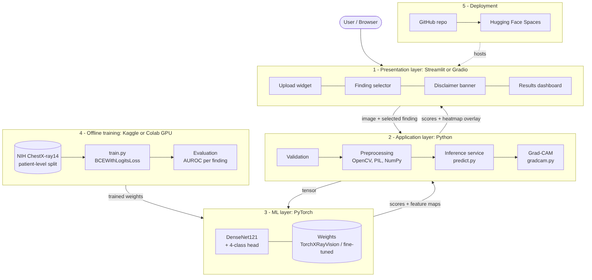

# 🫁 AI-Powered Chest X-Ray Analysis

> ⚠️ **Research / educational prototype. Not a medical diagnosis and not a medical device.**
> Scores are model outputs, not probabilities of disease. Always consult a qualified medical professional.

Upload a chest X-ray, get scores for **Pneumonia, Cardiomegaly, Pleural Effusion and Pneumothorax**, and see a **Grad-CAM heatmap** of the regions that influenced each score.

**Pipeline:** upload → validation → preprocessing → DenseNet121 → scores → Grad-CAM → dashboard → human review



## Features
- Pretrained DenseNet121 ([TorchXRayVision](https://github.com/mlmed/torchxrayvision), weights `densenet121-res224-all`)
- Multi-finding scores (the model has 18 outputs; 4 are shown, all 18 optional in the sidebar)
- Grad-CAM explanations with an opacity slider and PNG download
- Upload validation: file type, size (10 MB), readability, minimum resolution, grayscale check
- Clear handling of empty heatmaps (normal for low-scoring findings)
- Optional fine-tuning script with patient-level splits
- 18 automated tests

## Quick start
```bash
git clone <your-repo-url> && cd xray-ai
python -m venv .venv && source .venv/bin/activate      # Windows: .venv\Scripts\activate
pip install -r requirements.txt
streamlit run app/streamlit_app.py
```
The first run downloads the model weights (~30 MB). CPU is enough: one image takes about 0.3 s for scores and about 1 s per heatmap.

## Project structure
```
xray-ai/
├── app/streamlit_app.py     # UI
├── src/
│   ├── config.py            # labels, limits, disclaimer
│   ├── preprocess.py        # validation + normalisation to [-1024, 1024], crop, 224x224
│   ├── model.py             # loads pretrained DenseNet121
│   ├── predict.py           # scores for all / target findings
│   └── gradcam.py           # heatmap + overlay
├── scripts/finetune.py      # optional fine-tuning (NIH ChestX-ray14)
├── tests/test_pipeline.py   # pytest suite
├── sample_images/           # public sample X-ray
├── assets/                  # flowchart + architecture diagrams (PNG + Mermaid)
└── SPEC.md                  # full project specification
```

## Run the tests
```bash
pytest -q
```

## Deploy free on Hugging Face Spaces
1. Create a new Space, choose **Streamlit**.
2. Push this repository (the YAML block at the top of this README configures it).
3. Spaces installs `requirements.txt` and serves the app. CPU basic tier is enough.

## Fine-tuning (optional)
```bash
python scripts/finetune.py --imgpath /path/to/NIH/images --csv /path/to/Data_Entry_2017.csv --epochs 3
```
Run it on Kaggle or Colab with a GPU. Use `--limit 2000` for a quick smoke test first. This script was not run in the build environment, so expect small path or batch-size adjustments.

## Design notes
- **Normalisation matters.** The model expects pixel values in [-1024, 1024]. Skipping this gives wrong predictions with no error, so it is handled in `src/preprocess.py`.
- **Outputs are already in [0, 1]** (TorchXRayVision normalises them), so no extra sigmoid is applied.
- **Empty heatmaps are expected.** Grad-CAM applies a ReLU. When no region raises a finding's score, the map is all zeros and the app says so.
- **Level labels** (Low < 0.30, Moderate < 0.60, High) are display bands, not clinical thresholds.

## Limitations and ethics
- Not clinically validated and not for patient care.
- The pretrained weights were trained on public datasets whose labels were produced partly by automated text mining and are noisy.
- Performance may not transfer to other hospitals, scanners or populations.
- Because the weights already saw NIH, CheXpert and other datasets, evaluating on those same datasets overstates real-world performance.
- Grad-CAM shows where the model looked, not medical truth.
- Do not upload identifiable patient data. Uploads are processed in memory and not stored.

## Credits
- [TorchXRayVision](https://github.com/mlmed/torchxrayvision) (Cohen et al.)
- [pytorch-grad-cam](https://github.com/jacobgil/pytorch-grad-cam)
- Sample image: from the TorchXRayVision test set (NIH ChestX-ray8 sample).
